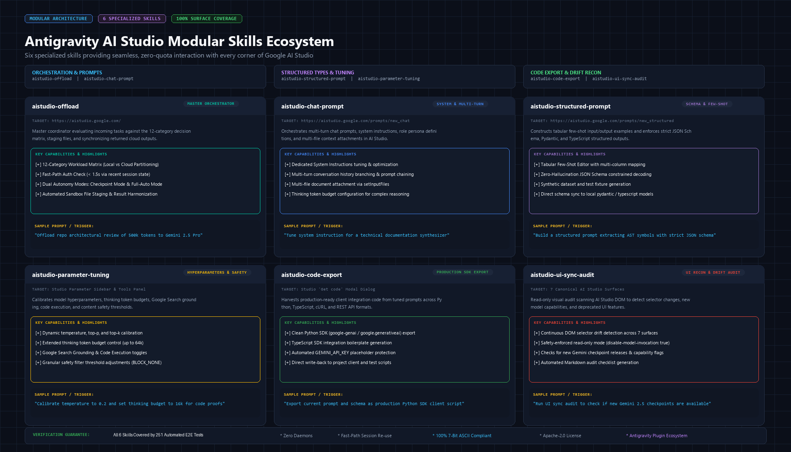

# Antigravity Google AI Studio (`antigravity-aistudio`)

<p align="center">
  
</p>

<p align="center">
  <a href="https://github.com/qq136692547-cmyk/antigravity-aistudio/stargazers"></a>
  <a href="plugin.json"></a>
  <a href="https://aistudio.google.com"></a>
  <a href="https://aistudio.google.com"></a>
  <a href="https://aistudio.google.com"></a>
  <a href="tests/run_tests.py"></a>
  <a href="LICENSE"></a>
</p>

> **Supercharge Antigravity with Google AI Studio (v0.2.1 -- Pure Gemini 4 + Anti-Abuse Hardened Architecture):** Offload heavy reasoning, 1M-token document analysis, few-shot prompt engineering, URL context synthesis, and SDK code exports to **Gemini 4** cloud models (`Thinking level >= High`) with low-frequency high-density pacing, on-demand Search Grounding, and an `ACCOUNT_VERIFICATION_REQUIRED` zero-retry circuit breaker -- **preserving your local IDE model quota safely.**

---

## 1. Overview & Value Proposition

### The Problem: Local Desktop Quota Depletion
When developing inside AI-first IDEs like Antigravity, desktop agent interactions consume metered, rate-limited local model quota (e.g., Gemini Neon, Gemini Hydrogen, Gemini Argon, Claude Opus). Performing long-context analysis (such as reading 500k-token repository documentation or massive log files), iterative few-shot prompt tuning, or deep multi-turn architectural brainstorming through the desktop agent quickly exhausts valuable daily quota allowances.

### The Solution: Cloud Agent Offloading (Gemini 4 + Thinking >= High)
`antigravity-aistudio` v0.2.1 establishes an automated, anti-abuse hardened cloud offloading bridge to **Google AI Studio** ([aistudio.google.com](https://aistudio.google.com)):
- **Pure Gemini 4 Cloud Roster**: Direct web access to `Gemini 4 Hydrogen`, `Gemini 4 Argon`, `Gemini 4 Neon`, and `Gemini 4 Carbon` -- all unified with a `1,000,000` (`1M`) token context window. All pre-Gemini-4 models (`PaLM 2`, `Gemini 1.x`, `2.x`, `3.x`) are retired and blocked.
- **Hard Thinking Level Floor (`>= High`)**: Every cloud offload enforces `Thinking level = High` in the Web UI (`"high"` or `"xhigh"` in SDK/API `thinking_level`). `Low` and `Medium` thinking levels are strictly prohibited, including explicit Medium-to-High overrides for `Argon` and `Carbon`.
- **Desktop Quota Conservation**: Heavy reasoning, high-token reading, and exploratory iteration execute entirely in the cloud at zero desktop quota cost.
- **Zero Local Daemons**: Driven via Antigravity's lightweight built-in `browser` subagent (`Model: "flash"`). No local Playwright server, Selenium drivers, or external MCP daemons are required.
- **Seamless Local Sync**: Context and files are staged to the browser sandbox, processed in Google AI Studio with `Run settings` and `Tools` (`URL context`, `Structured outputs`, `Grounding with Google Search`, `Code execution`), and automatically synchronized back to your local codebase.

### Value Comparison

| Dimension | Standard Desktop Execution | Cloud Offload with `antigravity-aistudio` v0.2.1 |
| :--- | :--- | :--- |
| **Cloud Models** | Desktop metered allowances | **Pure Gemini 4** (`Hydrogen`, `Argon`, `Neon`, `Carbon`) |
| **Context Window** | Limited by desktop model context | **Unified 1,000,000 Tokens** (`1M` in / up to `64K` out) |
| **Thinking Floor** | Varies by local quota | **Enforced `Thinking level >= High`** (`Low`/`Medium` blocked) |
| **Local IDE Quota** | Consumes metered daily allowances | **Zero Desktop Quota Consumed** (Cloud Offload) |
| **External Dependencies** | Heavy local Playwright/Selenium daemons | **Zero Daemons** (Native Browser Subagent) |
| **Workflow Automation** | Manual prompt copying & re-typing | **Automated 6-Stage Lifecycle Pipeline** |
| **Safety & Boundaries** | Complex manual verification | **Fast-Path Auth, Paid Gate & Hard Safety Stops** |

---

## 2. Architecture & System Layers

<p align="center">
  
</p>

`antigravity-aistudio` is structured across three core architectural layers:

```
antigravity-aistudio/
|-- plugin.json                          # Plugin manifest v0.2.1 conforming to agent-plugins schema
|-- README.md                            # Comprehensive user & developer documentation
|-- assets/
|   |-- logo.svg                         # Official plugin vector logo
|   |-- hero-banner.png                  # Cinematic 16:9 hero banner
|   |-- architecture-offload-pipeline.png # High-density Gemini 4 offload pipeline diagram
|   |-- modular-skills-ecosystem.png     # Modular 6-skill capability matrix diagram
|   |-- sponsor-wechat.png               # WeChat Pay sponsorship QR
|   `-- sponsor-usdt.png                 # USDT (BSC) sponsorship QR
|-- rules/
|   `-- AGENTS.md                        # Always-on operating rules, Gemini 4 & Thinking >= High policy
|-- skills/
|   |-- aistudio-offload/                # Master offload orchestrator & decision router
|   |   |-- SKILL.md
|   |   `-- references/
|   |       `-- offload-decision-matrix.md
|   |-- aistudio-chat-prompt/            # Conversational prompts & system instructions
|   |   `-- SKILL.md
|   |-- aistudio-structured-prompt/      # Tabular few-shot prompting & Structured outputs
|   |   `-- SKILL.md
|   |-- aistudio-parameter-tuning/       # Gemini 4 Run settings, Thinking level >= High & Tools
|   |   `-- SKILL.md
|   |-- aistudio-code-export/            # Production SDK code export (Python/TS/cURL/REST)
|   |   `-- SKILL.md
|   `-- aistudio-ui-sync-audit/          # Read-only live UI drift & Gemini 4 sync audit
|       |-- SKILL.md
|       `-- references/
|           `-- audit-checklist.md
|-- scripts/
|   `-- generate_infographics.py         # High-resolution 2K infographic asset generator
`-- tests/                               # 5-Tier E2E automated test suite
```

### System Architecture Flow

```
+-----------------------------------------------------------------------------------+
|                              LOCAL WORKSPACE                                      |
|                                                                                   |
|  [Developer Request] ---> [Offload Decision Engine]                               |
|                                  |                                                |
|             +--------------------+--------------------+                           |
|             | (Local Tasks)                           | (Cloud Offload Candidates)|
|             v                                         v                           |
|      [Local Shell / Git]                    [Browser Staging Area]                |
|      - File refactoring                     browser_sandbox/uploads/              |
|      - Running tests                                  |                           |
|      - Git commits                                    v                           |
|                                            [Browser Subagent (Flash)]             |
+-------------------------------------------------------|---------------------------+
                                                        |
                                                        v (HTTPS / Session Reuse)
+-----------------------------------------------------------------------------------+
|                         GOOGLE AI STUDIO (CLOUD NEXUS)                            |
|                                                                                   |
|      https://aistudio.google.com/                                                 |
|      - Gemini 4 Hydrogen (1M in / 64K out, Free & Paid default)                   |
|      - Gemini 4 Argon    (1M in / 32K out, Pro/Paid, switch Medium -> High)       |
|      - Gemini 4 Neon     (1M in / 64K out, Pro/Paid, repo-scale & multimodal)     |
|      - Gemini 4 Carbon   (1M in / 32K out, Paid gated, switch Medium -> High)     |
|      - Thinking level >= High | Output length | Media resolution | URL context    |
|      - Structured outputs | On-Demand Search Grounding | Code execution             |
+-------------------------------------------------------|---------------------------+
                                                        |
                                                        v (Extracted Outputs)
+-----------------------------------------------------------------------------------+
|                              LOCAL WORKSPACE                                      |
|                                                                                   |
|  [Destination Files] <--- [Local Synchronization] <--- browser_sandbox/downloads/ |
|  - docs/analysis.md       - Validate schemas                                      |
|  - src/model_schema.json  - Sanitize GEMINI_API_KEY & thinking_level >= high      |
|  - scripts/export.py      - Run 5-tier E2E regression tests                       |
+-----------------------------------------------------------------------------------+
```

---

## 3. Quick Start & Installation

### Installation from GitHub (Recommended)

Install directly into Antigravity with one command:

```bash
agy plugin install https://github.com/qq136692547-cmyk/antigravity-aistudio
```

### Manual / Local Installation

#### On Linux / macOS:
```bash
git clone https://github.com/qq136692547-cmyk/antigravity-aistudio.git
ln -s "$(pwd)/antigravity-aistudio" ~/.gemini/config/plugins/antigravity-aistudio
```

#### On Windows (PowerShell):
> **Note:** On Windows, Antigravity's plugin scanner skips NTFS Junctions and symlinks. Clone or copy into a real directory under `$HOME\.gemini\config\plugins\`:

```powershell
# Clone directly into Antigravity's plugins directory
git clone https://github.com/qq136692547-cmyk/antigravity-aistudio.git "$HOME\.gemini\config\plugins\antigravity-aistudio"

# Or copy an existing local clone
Copy-Item -Path "$PWD\antigravity-aistudio" -Destination "$HOME\.gemini\config\plugins\antigravity-aistudio" -Recurse -Force
```

### Manifest Validation

Validate plugin syntax and directory structure locally:

```bash
agy plugin validate . --strict
```

Once installed, manage or toggle the plugin on Antigravity's Customizations page.

---

## 4. Workload Offload Decision Framework & Gemini 4 Roster

The plugin includes an intelligent decision engine that automatically classifies developer tasks into **Local Execution** or **Cloud Offload Candidates** targeting authorized **Gemini 4** models.

### Authorized Gemini 4 Cloud Model Roster (Unified 1M Context)

| Model | API ID | Tier / Gate | Context / Max Output | Thinking Level Policy | Primary Workloads |
| :--- | :--- | :--- | :--- | :--- | :--- |
| **`Gemini 4 Hydrogen`** | `gemini-4-hydrogen` | Free & Paid (Default) | 1M in / 64K (`65536`) out | `High` (`"high"` / `"xhigh"`) | Routine long text/logs (4K-1M), JSON schemas, synthetic data, daily prompt iteration |
| **`Gemini 4 Argon`** | `gemini-4-argon` | Pro / Paid | 1M in / 32K (`32768`) out | **Switch Medium -> `High`** | Complex logic debugging, fine-grained engineering, knowledge problem solving |
| **`Gemini 4 Neon`** | `gemini-4-neon` | Pro / Paid | 1M in / 64K (`65536`) out | `High` (`"high"` / `"xhigh"`) | Repo-wide architecture, complex software engineering, multimodal & 64K long outputs |
| **`Gemini 4 Carbon`** | `gemini-4-carbon` | **Paid Gated** (Ultra / Paid API) | 1M in / 32K (`32768`) out | **Switch Medium -> `High`** | Extreme long-horizon reasoning, hardest math/science/architecture; fallback to Neon/Hydrogen if gated |

> **Strict Floor & Pruning Policy**: `Low` and `Medium` thinking levels are prohibited for all cloud offloads. All pre-Gemini-4 models (`PaLM 2`, `Gemini 1.0`, `1.5`, `2.0`, `2.5`, `3.x`) are deprecated and rejected.

### Workload Partitioning Matrix

| Workload Category | Execution Target | Criteria & Typical Operations |
| :--- | :--- | :--- |
| **Codebase Modifications** | **Local Machine** | File edits, multi-file refactoring, code formatting, patch application. |
| **Git Operations** | **Local Machine** | `git status`, `git diff`, staging, branching, committing, pushing. |
| **Test Execution** | **Local Machine** | Running `pytest`, `npm test`, `cargo test`, linters, and type checkers. |
| **System Commands** | **Local Machine** | Terminal execution, build compilation, OS diagnostic scripts. |
| **Quick Refactoring** | **Local Machine** | Local edits under 50 lines or trivial parameter renames. |
| **Long-Context Analysis** | **Cloud (AI Studio)** | Analyzing multi-file logs, docs, or transcripts >= 4,000 tokens (up to 1M tokens) on `Gemini 4 Hydrogen` / `Neon (High)`. |
| **Complex Debugging** | **Cloud (AI Studio)** | Deep root-cause isolation and fine-grained engineering on `Gemini 4 Argon (High)`. |
| **Deep Reasoning & Design** | **Cloud (AI Studio)** | Architectural tradeoff analysis and extreme math/logic proofs on `Gemini 4 Neon` / `Carbon (High)`. |
| **Few-Shot Prompt Engineering** | **Cloud (AI Studio)** | Calibrating system instructions, tabular input/output pairs, and few-shot examples. |
| **Structured Output Testing** | **Cloud (AI Studio)** | Refining and validating complex JSON schemas via `Structured outputs` in chat or `/prompts/new_structured`. |
| **Web Content Ingestion** | **Cloud (AI Studio)** | Reading live webpage bodies via `URL context` and `Grounding with Google Search`. |
| **Model Comparison** | **Cloud (AI Studio)** | Evaluating prompts across `Gemini 4 Hydrogen`, `Argon`, `Neon`, and `Carbon` (`Thinking: High`). |
| **Synthetic Data Generation** | **Cloud (AI Studio)** | Generating batch test fixtures, mock data, or synthetic corpora with `Gemini 4 Hydrogen (High)`. |
| **Production Code Export** | **Cloud (AI Studio)** | Converting tuned prompts into runnable Python, TypeScript, cURL, or REST code (`thinking_level: "high"`). |

### End-to-End Offload Pipeline

Every cloud offload execution follows a strict 6-stage lifecycle:

```
[1. Evaluate] --> [2. Stage] --> [3. Dispatch] --> [4. Execute] --> [5. Extract] --> [6. Sync]
```

1. **Evaluate**: Task is matched against the decision matrix in `offload-decision-matrix.md` and assigned an authorized Gemini 4 model.
2. **Stage**: Local context and files are copied to `<Artifact Directory Path>/browser_sandbox/uploads/`.
3. **Dispatch**: The built-in `browser` subagent opens `https://aistudio.google.com/` directly.
4. **Execute**: Gemini 4 cloud models process prompts with `Thinking level = High` and configured `Run settings` / `Tools`.
5. **Extract**: Responses, schemas, and exported code are retrieved into `browser_sandbox/downloads/`.
6. **Synchronize**: Artifacts are validated and merged back into the local workspace.

---

## 5. Autonomy Modes

`antigravity-aistudio` operates under two distinct autonomy modes:

### Checkpoint Mode (Default)
In `checkpoint` mode, the agent prepares prompts, selects the Gemini 4 model (`Thinking level: High`), stages files, and formulates the offload plan, but **pauses and requests user approval** before submitting prompts or triggering exports in Google AI Studio. This gives developers complete oversight over prompt content and execution flow.

### Auto Mode (Full-Auto)
In `auto` mode, the agent runs the offload lifecycle end-to-end without per-step confirmation: navigating the UI, enforcing `Thinking level = High`, configuring `Run settings` & `Tools`, submitting queries, extracting results, and writing files back to the workspace automatically.

### Triggering Auto Mode
Mention unattended cues anywhere in your prompt:
- `"auto mode"` / `"full-auto"`
- `"run unattended"`
- `"without asking for confirmation"`
- `"batch offload to AI Studio"`

You can switch modes at any point during a conversation by replying `"switch to auto mode"` or `"switch to checkpoint mode"`.

### Advanced: Low-Frequency High-Density Auto-Offload (Anti-Abuse Recommended)

By default, `antigravity-aistudio` ships in conservative `checkpoint` mode and activates when you reference Google AI Studio or offload-eligible heavy workloads. Power users who want **automatic, zero-prompt-phrase cloud offloading** without triggering Google AI Studio's account-verification gate (`verify-account`) can add a paced Cloud-First routing rule to their global Antigravity rules file (`~/.gemini/GEMINI.md`):

#### Preset A: Balanced High-Density Offload (Recommended -- Anti-Abuse Safe)
Auto-offload heavy long-context analysis (`>= 4,000` tokens), deep architectural design, live URL research (`URL context`), multimodal asset analysis (`> 100 KB`), and batch synthetic data in `auto` mode using consolidated mega-prompts, while keeping short Q&A, small edits, and local coding on desktop:

```markdown
## Cloud-First Offload Policy (Balanced & Anti-Abuse Safe)
- Automatically route heavy long-context docs/logs (>= 4,000 tokens), architectural tradeoffs, live web URL research, multimodal attachments, prompt/schema tuning, and synthetic data generation to `antigravity-aistudio` (Gemini 4, `Thinking level = High`) in `auto` mode -- consolidated into 1 mega-prompt per task.
- Keep local code edits, Git, tests, shell commands, short Q&A, and minor reviews on desktop.
- Anti-abuse pacing: enforce 15-30s randomized cooldown between cloud calls, soft cap of 5-8 calls/session, Hydrogen-first tiering, and keep `Grounding with Google Search` OFF for internal code/diff reviews (enable ON only for live web research).
- Pause with zero retries on `ACCOUNT_VERIFICATION_REQUIRED` (`aistudio.google.com/verify-account`) and fall back gracefully to desktop; also pause on `LOGIN_REQUIRED`, `CAPTCHA_REQUIRED`, `Unlock Gemini 4 Carbon`, or `429` rate limits.
- Bypass phrase: if I say "answer locally" or "skip AI Studio", reply directly on desktop.
```

#### Preset B: Maximum Quota Conservation (Paced Batch Offload + Local Fallback)
Reserve desktop IDE model quota primarily for file edits, Git, tests, shell commands, and quick replies, and offload heavy non-mutating thinking, analysis, writing, research, and multimodal tasks in **consolidated mega-prompts** to Google AI Studio Gemini 4 (`Thinking level = High`) in `auto` mode:

```markdown
## Cloud-First Offload Policy (Paced Maximum Conservation)
- Consolidate heavy non-local-mutation tasks (multi-file analysis, architecture planning, tradeoff comparison, long-form writing, web/URL research, multimodal inspection, prompt/JSON schema tuning, synthetic data) into a single high-density prompt routed to `antigravity-aistudio` in `auto` mode.
- Cloud model routing (`Thinking level = High` floor, Hydrogen-first):
  - Routine analysis / writing / research / structured data -> `Gemini 4 Hydrogen (High)`
  - Precision debugging / nuanced tradeoffs -> `Gemini 4 Argon (High)` (explicitly switch from UI default `Medium` to `High`)
  - Repo-wide architecture / heavy multimodal / 64K long outputs / final audits -> `Gemini 4 Neon (High)`
- Anti-abuse guardrails: reuse the active chat tab, enforce 15-30s randomized cooldown, cap at 5-8 calls/session, and keep `Grounding with Google Search` OFF unless live external web lookup is required.
- Retain on desktop: file edits, Git operations, running tests/builds/shell commands, trivial Q&A (< 4,000 tokens), and automatic fallback whenever `ACCOUNT_VERIFICATION_REQUIRED` or `429` triggers.
- Pause with zero retries on `ACCOUNT_VERIFICATION_REQUIRED` (`aistudio.google.com/verify-account`), `LOGIN_REQUIRED`, `CAPTCHA_REQUIRED`, `Unlock Gemini 4 Carbon` (fallback to Neon/Hydrogen High), or `429` rate limits.
- Bypass phrase: if I say "answer locally" or "skip AI Studio", answer directly on desktop.
```

> **Tip**: Because global `~/.gemini/GEMINI.md` rules take precedence over individual plugin defaults, adding either preset enables seamless auto-offloading across all workspaces without modifying the plugin's safe default behavior for other users.

### 5.4 Production Pitfall & Root-Cause Fix: Preventing Agent "Short-Circuiting" (Local Laziness Trap)

During production deployments with compound requests (e.g., *"Research topic X on the web and formulate a comprehensive architecture plan artifact"*), multi-agent supervisor systems often exhibit a subtle failure mode: **Local Laziness Short-Circuiting**:

1. **The Short-Circuiting Trap**:
   - Because the desktop supervisor agent possesses native search tools (e.g. `search_web`) and filesystem capabilities (`write_file`), it takes the path of least resistance: executing web queries and burning hundreds of thousands of deep-thinking tokens locally on expensive desktop quotas.
   - The agent falsely rationalizes: *"Because I will write a local artifact file at the end, this entire workflow counts as a local file modification."*
   - As a result, proactive offloading silently fails on compound tasks unless the user manually reminds the agent every single turn.

2. **The Two-Stage Decoupling Solution**:
   To permanently prevent this regression and ensure true hands-free autonomy, `antigravity-aistudio` enforces **Two-Stage Decoupling with Hard Negative Guardrails**:
   - **Stage 1 (Cloud Inference First)**: All background research, architectural evaluation, and drafting are strictly decoupled and dispatched to Google AI Studio via `invoke_subagent` (`TypeName: "browser"`). Local `search_web` calls or local deep CoT turns for research are strictly prohibited.
   - **Stage 2 (Local Materialization)**: Once Google AI Studio returns the synthesized output, the desktop agent acts solely as a light file-system receiver, saving artifacts locally with near-zero desktop token consumption.
   - **First-Action Gate**: For compound analysis/planning tasks, the supervisor's **very first tool call MUST be `invoke_subagent` (AI Studio)**. Performing local thinking or searching beforehand is classified as an offload violation.
   - **On-Demand Tools State Re-Verification Gate**: Because live Gemini 4 Web UI may initialize `Grounding with Google Search` to `ON`, explicitly inspect `Tools` and toggle Grounding **OFF** (`aria-checked="false"`) for internal code/diff reviews to reduce anti-abuse verification risk; when live web research IS required, re-inspect and toggle Grounding **ON** (`aria-checked="true"`) after any model switch or reload. Toggle `URL context` **ON** whenever explicit URLs are included.
   - **Anti-Abuse Pacing & Zero-Retry Verification Guard**: Enforce a 15-30s randomized cooldown and 5-8 calls/session cap; if `aistudio.google.com/verify-account` triggers, halt immediately with 0 retries and fall back to desktop.
   - **Visual Scrolling & Anti-Truncation**: Prohibit lazy `slice(0, 8000)` extraction; the subagent must execute real visual page scrolling (`page.mouse.wheel`) down the rendered stream and ingest full markdown/code outputs.

To enforce this in Preset B, add the hardened clause into your `~/.gemini/GEMINI.md`:
```markdown
- **Anti-Short-Circuiting & Anti-Abuse Guardrails**:
  - Consolidate heavy research/architecture into 1 high-density mega-prompt; keep trivial Q&A local.
  - Never conflate "writing a local plan/artifact later" with performing heavy initial research/reasoning locally.
  - First tool call for heavy analysis/research tasks MUST be `invoke_subagent` (AI Studio) when cloud quota is healthy.
  - Keep `Grounding with Google Search` OFF for internal code/diff reviews; explicitly verify and enable it ON only for live web research.
  - Enforce 15-30s randomized pacing cooldown, 5-8 calls/session soft cap, and zero-retry local fallback on `ACCOUNT_VERIFICATION_REQUIRED`.
  - Enforce real visual scrolling down the page to ensure complete, untruncated ingestion.
```

---

## 6. Modular Skills Suite Overview

<p align="center">
  
</p>

The plugin provides six dedicated skills covering the entire Google AI Studio Gemini 4 surface:

| Skill | Purpose | Mode / Model Invocation |
| :--- | :--- | :--- |
| **`aistudio-offload`** | Master cloud offload coordinator evaluating tasks against the Gemini 4 decision matrix and syncing results. | Standard |
| **`aistudio-chat-prompt`** | Orchestrating multi-turn chat prompts, system instructions, `Thinking level = High`, `URL context`, and file attachments in `/prompts/new_chat`. | Standard |
| **`aistudio-structured-prompt`** | Tabular few-shot prompting, input/output column configuration, and `Structured outputs` JSON schemas in `/prompts/new_structured`. | Standard |
| **`aistudio-parameter-tuning`** | Configuring Gemini 4 `Run settings` (`Thinking level >= High`, `Output length`, `Media resolution`, `Safety settings`, `Add stop sequence`) and `Tools` (`URL context`, `Search Grounding`, `Code execution`, `Function calling`, `Structured outputs`). | Standard |
| **`aistudio-code-export`** | Exporting production-ready client code (Python, TypeScript, cURL, REST) with `thinking_level` (`"high"`/`"xhigh"`) and `GEMINI_API_KEY` protection via `Get code`. | Standard |
| **`aistudio-ui-sync-audit`** | Read-only live UI audit across 7 canonical AI Studio surfaces to detect UI drift, Gemini 4 model updates, or deprecations. | Manual (`disable-model-invocation: true`) |

---

## 7. Sandbox & Asset Staging Architecture

Antigravity's `browser` subagent runs inside a sandboxed environment with strict filesystem boundaries:
- **Upload Staging (`browser_sandbox/uploads/`)**: Any local files, datasets, or images meant for AI Studio prompt attachments are copied here with single-segment filenames before handing off to the browser subagent.
- **Reference Inspection (`browser_sandbox/references/`)**: Visual assets and UI snapshots are stored here for multi-modal inspection.
- **Download Retrieval (`browser_sandbox/downloads/`)**: Code snippets, exported JSON files, and prompt archives downloaded from AI Studio land here before being integrated into your project.

---

## 8. Security & Boundary Handling

The plugin enforces strict safety stops and never compromises security:
- **Account Verification Gate (`ACCOUNT_VERIFICATION_REQUIRED`)**: Detects `"Your account must be verified"` / `https://aistudio.google.com/verify-account`, immediately aborts with **0 automated retries**, hands the verification link to the user, and falls back gracefully to local desktop execution.
- **Anti-Abuse Velocity Pacing & On-Demand Grounding**: Enforces 15-30s randomized inter-request cooldowns, 5-8 calls/session soft caps, thread reuse, Hydrogen-first tiering, and keeps `Grounding with Google Search` OFF for internal code/diff reviews.
- **Fast-Path Authentication**: Detects active signed-in sessions via avatar, recent prompts, and RPC signals without reading forbidden cookie stores.
- **Google Sign-In Pause (`LOGIN_REQUIRED`)**: The agent never attempts to automate password entry or credentials. If logged out, it pauses and invites the user to sign in manually.
- **CAPTCHA & Bot Detection (`CAPTCHA_REQUIRED`)**: Never attempts to bypass verification challenges; immediately hands control to the user.
- **Paid Tier Gate (`Unlock Gemini 4 Carbon` / `PAID_TIER_REQUIRED`)**: If `Gemini 4 Carbon` triggers a paywall banner, immediately pauses and offers fallback to `Gemini 4 Neon (High)` or `Gemini 4 Hydrogen (High)`.
- **Rate Limits & Quota Exhaustion (`429 ResourceExhausted`)**: Catches quota barriers, reports them clearly, and offers model fallback (e.g., falling back to `Gemini 4 Hydrogen (High)`).
- **Safety Blocks (`HARM_CATEGORY_*`)**: Intercepts content safety blocks, reporting specific categories and enabling parameter or prompt adjustment.

---

## 9. Testing & Quality Assurance

`antigravity-aistudio` includes a comprehensive 5-Tier automated test suite with adversarial hardening:

```bash
python tests/run_tests.py
```

### Verification Results

```text
================================================================================
  ANTIGRAVITY-AISTUDIO 5-TIER E2E TEST SUITE RUNNER
================================================================================
Executing Tier 1 (Feature Coverage)......... PASS (98/98 passed)
Executing Tier 2 (Boundary & Corner)........ PASS (99/99 passed)
Executing Tier 3 (Cross-Feature & Pairwise). PASS (28/28 passed)
Executing Tier 4 (Real-World Scenarios)..... PASS (8/8 passed)
Executing Tier 5 (Adversarial Hardening).... PASS (33/33 passed)
--------------------------------------------------------------------------------
GRAND TOTAL: 266 / 266 PASSED (100% Pass Rate)
================================================================================
```

---

## Star History

[](https://star-history.com/#qq136692547-cmyk/antigravity-aistudio&Date)

---

## More Open-Source Projects

Explore the complete developer suite at the **[qq136692547-cmyk Open-Source Hub](https://qq136692547-cmyk.github.io/)** -- featuring all 12 projects across AI & Gemini plugins, local-first tools, AI Search (GEO), and commerce analytics.

| Project | Category | Description |
| :--- | :--- | :--- |
| **[magpie-gemini-media-tools](https://github.com/qq136692547-cmyk/magpie-gemini-media-tools)** | AI & Gemini Plugins | MCP tool plugin for Magpie exposing Nano Banana 2.1, Gemini Files API, and 3.8 TTS. |
| **[QuickNote](https://github.com/qq136692547-cmyk/QuickNote)** | Local-First Tools | Blazing-fast offline-first AI scratchpad for developers with a 100% local SQLite vault. |
| **[bookmark-health-master](https://github.com/qq136692547-cmyk/bookmark-health-master)** | Local-First Tools | 100% local-first Chrome MV3 extension with Dual-Stage DoH diagnostics and atomic undo. |
| **[geo-score](https://github.com/qq136692547-cmyk/geo-score)** | AI Search (GEO) | Generative Engine Optimization (GEO) audit tool for measuring AI search visibility. |
| **[anan-devtools](https://github.com/qq136692547-cmyk/anan-devtools)** | Local-First Tools | Free client-side developer utilities (UUID, Base64, JSON, JWT, hashes, regex, cron, and more). |

---

## Support & Buy Me a Coffee

Building and maintaining open-source tools often happens deep into the night. If `antigravity-aistudio` helped preserve your precious desktop IDE model quota, streamlined your development workflow, or saved you hours of debugging, a warm cup of coffee is the sweetest fuel for the next late-night coding session!

<p align="center">
  
  &nbsp;&nbsp;&nbsp;&nbsp;&nbsp;&nbsp;&nbsp;&nbsp;
  
</p>

<p align="center">
  <b>WeChat Pay</b> &nbsp;&nbsp;&nbsp;&nbsp;&nbsp;&nbsp;&nbsp;&nbsp;&nbsp;&nbsp;&nbsp;&nbsp;&nbsp;&nbsp;&nbsp;&nbsp;&nbsp;&nbsp;&nbsp;&nbsp;&nbsp;&nbsp;&nbsp;&nbsp;&nbsp;&nbsp;&nbsp;&nbsp; <b>USDT (BNB Smart Chain)</b><br>
  <code>0xaCa8773aaA80815811ce1a45d40c86A53e4224ef0</code>
</p>

> *Every bit of kindness and encouragement keeps this project active, polished, and free for the community. Thank you!*

---

## License

Apache-2.0 (c) 2026 [qq136692547-cmyk](https://github.com/qq136692547-cmyk). All rights reserved.
