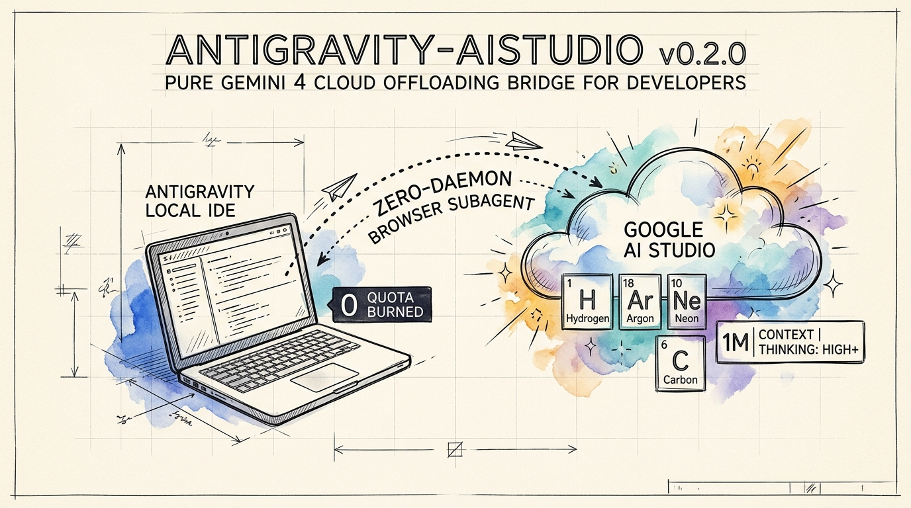
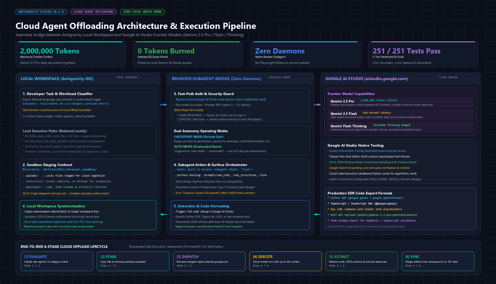

# Antigravity Google AI Studio (`antigravity-aistudio`)

<p align="center">
  
</p>

<p align="center">
  <a href="https://github.com/qq136692547-cmyk/antigravity-aistudio/stargazers"></a>
  <a href="plugin.json"></a>
  <a href="https://aistudio.google.com"></a>
  <a href="https://aistudio.google.com"></a>
  <a href="tests/run_tests.py"></a>
  <a href="LICENSE"></a>
</p>

> **Supercharge Antigravity with Google AI Studio:** Offload heavy reasoning, million-token document analysis, few-shot prompt engineering, and code exports to frontier cloud Gemini models through Antigravity's built-in browser subagent -- **preserving 100% of your local IDE model quota.**

---

## 1. Overview & Value Proposition

### The Problem: Local Desktop Quota Depletion
When developing inside AI-first IDEs like Antigravity, desktop agent interactions consume metered, rate-limited local model quota (e.g., Gemini Neon, Gemini Hydrogen, Gemini Argon, Claude Opus). Performing long-context analysis (such as reading 500k-token repository documentations or massive log files), iterative few-shot prompt tuning, or deep multi-turn architectural brainstorming through the desktop agent quickly exhausts valuable daily quota allowances.

### The Solution: Cloud Agent Offloading
`antigravity-aistudio` solves this bottleneck by establishing an automated cloud offloading bridge to **Google AI Studio** ([aistudio.google.com](https://aistudio.google.com)):
- **Frontier Cloud Models**: Direct web access to Gemini 2.5 Pro (up to 2,000,000 tokens context window), Gemini 2.5 Flash, and Gemini Flash Thinking directly inside Google AI Studio.
- **Desktop Quota Conservation**: Heavy reasoning, high-token reading, and exploratory iteration execute entirely in the cloud at zero desktop quota cost.
- **Zero Local Daemons**: Driven via Antigravity's lightweight built-in `browser` subagent (`Model: "flash"`). No local Playwright server, Selenium drivers, or external MCP daemons are required.
- **Seamless Local Sync**: Context and files are staged to the browser sandbox, processed in Google AI Studio, and automatically retrieved and synchronized back to your local codebase.

### Value Comparison

| Dimension | Standard Desktop Execution | Cloud Offload with `antigravity-aistudio` |
| :--- | :--- | :--- |
| **Context Window** | Limited by desktop model context | **Up to 2,000,000 Tokens** (Gemini 2.5 Pro) |
| **Local IDE Quota** | Consumes metered daily allowances | **Zero Desktop Quota Consumed** (Cloud Offload) |
| **External Dependencies**| Heavy local Playwright/Selenium daemons | **Zero Daemons** (Native Browser Subagent) |
| **Workflow Automation** | Manual prompt copying & re-typing | **Automated 6-Stage Lifecycle Pipeline** |
| **Safety & Boundaries** | Complex manual verification | **Fast-Path Auth & Hard Safety Stops** |

---

## 2. Architecture & System Layers

<p align="center">
  
</p>

`antigravity-aistudio` is structured across three core architectural layers:

```
antigravity-aistudio/
|-- plugin.json                          # Plugin manifest conforming to agent-plugins schema
|-- README.md                            # Comprehensive user & developer documentation
|-- assets/
|   |-- logo.svg                         # Official plugin vector logo
|   |-- hero-banner.png                  # Cinematic 16:9 hero banner
|   |-- architecture-offload-pipeline.png # High-density cloud offload pipeline diagram
|   |-- modular-skills-ecosystem.png     # Modular 6-skill capability matrix diagram
|   |-- sponsor-wechat.png               # WeChat Pay sponsorship QR
|   `-- sponsor-usdt.png                 # USDT (BSC) sponsorship QR
|-- rules/
|   `-- AGENTS.md                        # Always-on operating rules & offload decision engine
|-- skills/
|   |-- aistudio-offload/                # Master offload orchestrator & decision router
|   |   |-- SKILL.md
|   |   `-- references/
|   |       `-- offload-decision-matrix.md
|   |-- aistudio-chat-prompt/            # Conversational prompts & system instructions
|   |   `-- SKILL.md
|   |-- aistudio-structured-prompt/      # Tabular few-shot prompting & JSON schemas
|   |   `-- SKILL.md
|   |-- aistudio-parameter-tuning/       # Hyperparameters, safety filters & grounding
|   |   `-- SKILL.md
|   |-- aistudio-code-export/            # Production SDK code export (Python/TS/cURL)
|   |   `-- SKILL.md
|   `-- aistudio-ui-sync-audit/          # Read-only live UI drift & model sync audit
|       |-- SKILL.md
|       `-- references/
|           `-- audit-checklist.md
|-- scripts/
|   `-- generate_infographics.py         # High-resolution infographic asset generator
`-- tests/                               # 5-Tier E2E automated test suite (251 tests)
```

### System Architecture Flow

```
+-----------------------------------------------------------------------------------+
|                              LOCAL WORKSPACE                                      |
|                                                                                   |
|  [Developer Request] ---> [Offload Decision Engine]                               |
|                                  |                                                |
|             +--------------------+--------------------+                           |
|             | (Local Tasks)                           | (Cloud Offload Candidates)|
|             v                                         v                           |
|      [Local Shell / Git]                    [Browser Staging Area]                |
|      - File refactoring                     browser_sandbox/uploads/              |
|      - Running tests                                  |                           |
|      - Git commits                                    v                           |
|                                            [Browser Subagent (Flash)]             |
+-------------------------------------------------------|---------------------------+
                                                        |
                                                        v (HTTPS / Session Reuse)
+-----------------------------------------------------------------------------------+
|                         GOOGLE AI STUDIO (CLOUD NEXUS)                            |
|                                                                                   |
|      https://aistudio.google.com/                                                 |
|      - Gemini 2.5 Pro (2M Tokens Context)                                         |
|      - Gemini 2.5 Flash (Ultra-fast generation & structured output)               |
|      - Gemini Flash Thinking (Deep reasoning & mathematical proofs)               |
|      - Search Grounding, Code Execution & Structured JSON Schema Mode             |
+-----------------------------------------------------------------------------------+
                                                        |
                                                        v (Extracted Outputs)
+-----------------------------------------------------------------------------------+
|                              LOCAL WORKSPACE                                      |
|                                                                                   |
|  [Destination Files] <--- [Local Synchronization] <--- browser_sandbox/downloads/ |
|  - docs/analysis.md       - Validate schemas                                      |
|  - src/model_schema.json  - Sanitize GEMINI_API_KEY                               |
|  - scripts/export.py      - Run tests (251/251 PASS)                              |
+-----------------------------------------------------------------------------------+
```

---

## 3. Quick Start & Installation

### Installation from GitHub (Recommended)

Install directly into Antigravity with one command:

```bash
agy plugin install https://github.com/qq136692547-cmyk/antigravity-aistudio
```

### Local Development (Symlink)

#### On Linux / macOS:
```bash
git clone https://github.com/qq136692547-cmyk/antigravity-aistudio.git
ln -s "$(pwd)/antigravity-aistudio" ~/.gemini/config/plugins/antigravity-aistudio
```

#### On Windows (PowerShell):
```powershell
git clone https://github.com/qq136692547-cmyk/antigravity-aistudio.git
New-Item -ItemType Junction -Path "$HOME\.gemini\config\plugins\antigravity-aistudio" -Target "$PWD\antigravity-aistudio"
```

### Manifest Validation

Validate plugin syntax and directory structure locally:

```bash
agy plugin validate . --strict
```

Once installed, manage or toggle the plugin on Antigravity's Customizations page.

---

## 4. Workload Offload Decision Framework

The plugin includes an intelligent decision engine that automatically classifies developer tasks into **Local Execution** or **Cloud Offload Candidates**.

### Workload Partitioning Matrix

| Workload Category | Execution Target | Criteria & Typical Operations |
| :--- | :--- | :--- |
| **Codebase Modifications** | **Local Machine** | File edits, multi-file refactoring, code formatting, patch application. |
| **Git Operations** | **Local Machine** | `git status`, `git diff`, staging, branching, committing, pushing. |
| **Test Execution** | **Local Machine** | Running `pytest`, `npm test`, `cargo test`, linters, and type checkers. |
| **System Commands** | **Local Machine** | Terminal execution, build compilation, OS diagnostic scripts. |
| **Quick Refactoring** | **Local Machine** | Local edits under 50 lines or trivial parameter renames. |
| **Long-Context Analysis** | **Cloud (AI Studio)** | Analyzing multi-file logs, documentation repositories, or transcripts exceeding 4,000 tokens (up to 2M tokens). |
| **Deep Reasoning & Design** | **Cloud (AI Studio)** | Architectural tradeoff analysis, algorithm synthesis, design brainstorming with Gemini Flash Thinking. |
| **Few-Shot Prompt Engineering**| **Cloud (AI Studio)** | Calibrating system instructions, tabular input/output pairs, and few-shot examples. |
| **Structured Output Testing** | **Cloud (AI Studio)** | Refining and validating complex JSON schemas and constrained decoding. |
| **Model Comparison** | **Cloud (AI Studio)** | Evaluating prompts across Gemini 2.5 Pro, Flash, and Flash Thinking models. |
| **Synthetic Data Generation** | **Cloud (AI Studio)** | Generating batch test fixtures, mock data, or synthetic corpora. |
| **Production Code Export** | **Cloud (AI Studio)** | Converting tuned prompts into runnable Python, TypeScript, or cURL code. |

### End-to-End Offload Pipeline

Every cloud offload execution follows a strict 6-stage lifecycle:

```
[1. Evaluate] --> [2. Stage] --> [3. Dispatch] --> [4. Execute] --> [5. Extract] --> [6. Sync]
```

1. **Evaluate**: Task is matched against the decision matrix in `offload-decision-matrix.md`.
2. **Stage**: Local context and files are copied to `<Artifact Directory Path>/browser_sandbox/uploads/`.
3. **Dispatch**: The built-in `browser` subagent opens `https://aistudio.google.com/` directly.
4. **Execute**: Cloud models process prompts with full context window and tools enabled.
5. **Extract**: Responses, schemas, and exported code are retrieved into `browser_sandbox/downloads/`.
6. **Synchronize**: Artifacts are validated and merged back into the local workspace.

---

## 5. Autonomy Modes

`antigravity-aistudio` operates under two distinct autonomy modes:

### Checkpoint Mode (Default)
In `checkpoint` mode, the agent prepares prompts, selects models, stages files, and formulates the offload plan, but **pauses and requests user approval** before submitting prompts or triggering exports in Google AI Studio. This gives developers complete oversight over prompt content and execution flow.

### Auto Mode (Full-Auto)
In `auto` mode, the agent runs the offload lifecycle end-to-end without per-step confirmation: navigating the UI, configuring model parameters, submitting queries, extracting results, and writing files back to the workspace automatically.

### Triggering Auto Mode
Mention unattended cues anywhere in your prompt:
- `"auto mode"` / `"full-auto"`
- `"run unattended"`
- `"without asking for confirmation"`
- `"batch offload to AI Studio"`

You can switch modes at any point during a conversation by replying `"switch to auto mode"` or `"switch to checkpoint mode"`.

---

## 6. Modular Skills Suite Overview

<p align="center">
  
</p>

The plugin provides six dedicated skills covering the entire Google AI Studio surface:

| Skill | Purpose | Mode / Model Invocation |
| :--- | :--- | :--- |
| **`aistudio-offload`** | Master cloud offload coordinator evaluating tasks against the decision matrix and syncing results. | Standard |
| **`aistudio-chat-prompt`** | Orchestrating multi-turn chat prompts, system instructions, and file attachments in `/prompts/new_chat`. | Standard |
| **`aistudio-structured-prompt`** | Tabular few-shot prompting, input/output column configuration, and JSON schema outputs in `/prompts/new_structured`. | Standard |
| **`aistudio-parameter-tuning`** | Fine-tuning temperature, top-p, top-k, thinking budget, safety thresholds, search grounding, and code execution. | Standard |
| **`aistudio-code-export`** | Exporting production-ready client code (Python, TypeScript, cURL, REST) via the `Get code` dialog. | Standard |
| **`aistudio-ui-sync-audit`** | Read-only live UI audit across 7 canonical AI Studio surfaces to detect new features or model deprecations. | Manual (`disable-model-invocation: true`) |

---

## 7. Sandbox & Asset Staging Architecture

Antigravity's `browser` subagent runs inside a sandboxed environment with strict filesystem boundaries:
- **Upload Staging (`browser_sandbox/uploads/`)**: Any local files, datasets, or images meant for AI Studio prompt attachments are copied here with single-segment filenames before handing off to the browser subagent.
- **Reference Inspection (`browser_sandbox/references/`)**: Visual assets and UI snapshots are stored here for multi-modal inspection.
- **Download Retrieval (`browser_sandbox/downloads/`)**: Code snippets, exported JSON files, and prompt archives downloaded from AI Studio land here before being integrated into your project.

---

## 8. Security & Boundary Handling

The plugin enforces strict safety stops and never compromises security:
- **Fast-Path Authentication**: Detects active signed-in sessions via avatar, recent prompts, and RPC signals without reading forbidden cookie stores.
- **Google Sign-In Pause (`LOGIN_REQUIRED`)**: The agent never attempts to automate password entry or credentials. If logged out, it pauses and invites the user to sign in manually.
- **CAPTCHA & Bot Detection (`CAPTCHA_REQUIRED`)**: Never attempts to bypass verification challenges; immediately hands control to the user.
- **Rate Limits & Quota Exhaustion (`429 ResourceExhausted`)**: Catches quota barriers, reports them clearly, and offers model fallback (e.g., falling back to Gemini Flash).
- **Safety Blocks (`HARM_CATEGORY_*`)**: Intercepts content safety blocks, reporting specific categories and enabling parameter or prompt adjustment.

---

## 9. Testing & Quality Assurance

`antigravity-aistudio` includes a comprehensive 5-Tier automated test suite with adversarial hardening:

```bash
python tests/run_tests.py
```

### Verification Results

```text
================================================================================
  ANTIGRAVITY-AISTUDIO 5-TIER E2E TEST SUITE RUNNER
================================================================================
Executing Tier 1 (Feature Coverage)......... PASS (95/95 passed)
Executing Tier 2 (Boundary & Corner)........ PASS (95/95 passed)
Executing Tier 3 (Cross-Feature & Pairwise). PASS (27/27 passed)
Executing Tier 4 (Real-World Scenarios)..... PASS (6/6 passed)
Executing Tier 5 (Adversarial Hardening).... PASS (28/28 passed)
--------------------------------------------------------------------------------
GRAND TOTAL: 251 / 251 PASSED (100% Pass Rate)
================================================================================
```

---

## Star History

[](https://star-history.com/#qq136692547-cmyk/antigravity-aistudio&Date)

---

## Support & Buy Me a Coffee

Building and maintaining open-source tools often happens deep into the night. If `antigravity-aistudio` helped preserve your precious desktop IDE model quota, streamlined your development workflow, or saved you hours of debugging, a warm cup of coffee is the sweetest fuel for the next late-night coding session!

<p align="center">
  
  &nbsp;&nbsp;&nbsp;&nbsp;&nbsp;&nbsp;&nbsp;&nbsp;
  
</p>

<p align="center">
  <b>WeChat Pay</b> &nbsp;&nbsp;&nbsp;&nbsp;&nbsp;&nbsp;&nbsp;&nbsp;&nbsp;&nbsp;&nbsp;&nbsp;&nbsp;&nbsp;&nbsp;&nbsp;&nbsp;&nbsp;&nbsp;&nbsp;&nbsp;&nbsp;&nbsp;&nbsp;&nbsp;&nbsp;&nbsp;&nbsp; <b>USDT (BNB Smart Chain)</b><br>
  <code>0xaCa8773aaA80815811ce1a45d40c86A53e4224ef0</code>
</p>

> *Every bit of kindness and encouragement keeps this project active, polished, and free for the community. Thank you!*

---

## License

Apache-2.0 (c) 2026 [qq136692547-cmyk](https://github.com/qq136692547-cmyk). All rights reserved.
